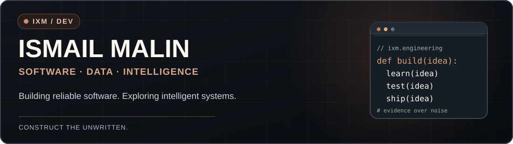
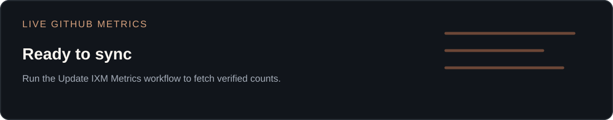
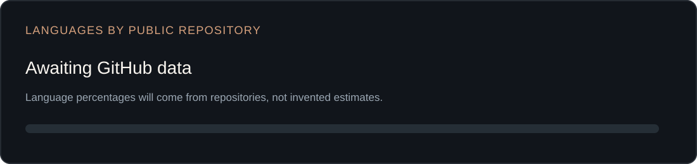
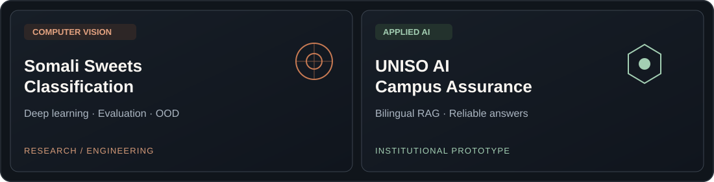
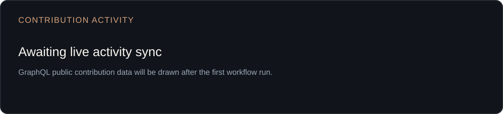

<!-- IXM GitHub Dashboard v3.0 | Ismail Malin -->

  <a href="https://ismailmalin.com"><b>PORTFOLIO</b></a> &nbsp; / &nbsp;
  <a href="https://ismailmalin.com/work"><b>WORK</b></a> &nbsp; / &nbsp;
  <a href="https://ismailmalin.com/writing"><b>WRITING</b></a> &nbsp; / &nbsp;
  <a href="https://github.com/ismailmalin?tab=repositories"><b>REPOSITORIES</b></a>

### Welcome to my engineering space.

I'm **Ismail**, a Computer Science graduate from Somalia. I write software, explore machine learning, and document the process — from university assignments and full-stack applications to applied AI systems.

- **Building:** Software, data applications, and machine learning systems.
- **Learning:** Reliable AI, ML engineering, and strong software fundamentals.
- **Working principle:** Understand → Build → Test → Record → Document → Publish.

### 01 / GitHub at a glance

### 02 / Selected engineering work

Featured source-code links, demos, and evaluation results will be added when each project is reviewed, tested, and approved for publication.

### 03 / Contribution activity

### 04 / Computer science archive

`Python & Algorithms` · `Java & OOP` · `Web & Backend` · `SQL & Databases` · `University Projects` · `Machine Learning`

**[Browse all repositories](https://github.com/ismailmalin?tab=repositories)**

IXM &nbsp; / &nbsp; CONSTRUCT THE UNWRITTEN &nbsp; · &nbsp; <a href="https://ismailmalin.com">ismailmalin.com</a>

