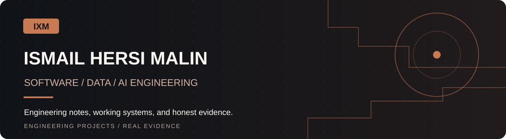
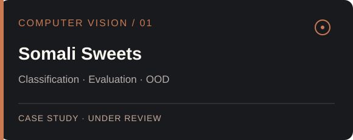
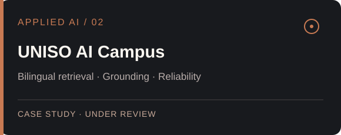

<a href="https://ismailmalin.com"><b>PORTFOLIO</b></a> &nbsp;·&nbsp;
<a href="https://ismailmalin.com/work"><b>PROJECTS</b></a> &nbsp;·&nbsp;
<a href="https://ismailmalin.com/writing"><b>WRITING</b></a> &nbsp;·&nbsp;
<a href="https://github.com/ismailmalin?tab=repositories"><b>CODE ARCHIVE</b></a>

I'm Ismail Hersi Malin, a Computer Science graduate building software and developing skills in reliable machine-learning engineering. This profile documents **what I built, how I tested it, and what I learned**—from university programming to applied AI.

### 01 / SELECTED WORK

Source code, real demos and results will be linked after review, testing and permission checks.

### 02 / ENGINEERING PRACTICE
`Python` · `Java` · `SQL` · `JavaScript / TypeScript` · `Machine Learning` · `Backend Systems` · `Testing`

**Workflow:** Understand → Design → Implement → Test → Evaluate → Document → Publish.

### 03 / THE DEVELOPMENT ARCHIVE

My repositories span university coursework, programming labs, web/backend applications, databases, data science, and AI/ML experiments. **Not every exercise needs to be a portfolio highlight.** Selected work is reviewed before public release.

[Explore repositories](https://github.com/ismailmalin?tab=repositories)

### 04 / CURRENT FOCUS
Building complete software systems, strengthening engineering fundamentals, and making machine-learning evaluation more reproducible and reliable.

---

<b>IXM</b> · ISMAIL HERSI MALIN &nbsp; | &nbsp; <a href="https://ismailmalin.com">ismailmalin.com</a>

