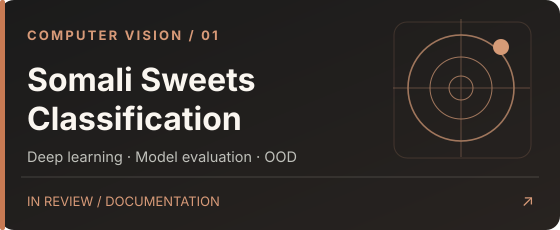
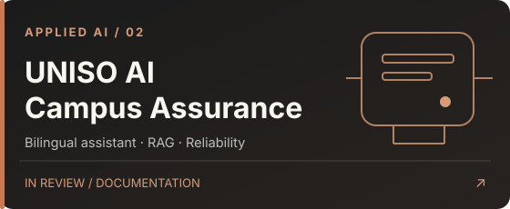

<!-- IXM — GitHub profile README, version 2.0 -->

  

  <a href="https://ismailmalin.com"><b>PORTFOLIO</b></a>
  &nbsp;&nbsp;•&nbsp;&nbsp;
  <a href="https://ismailmalin.com/work"><b>PROJECTS</b></a>
  &nbsp;&nbsp;•&nbsp;&nbsp;
  <a href="https://ismailmalin.com/writing"><b>WRITING</b></a>
  &nbsp;&nbsp;•&nbsp;&nbsp;
  <a href="https://github.com/ismailmalin?tab=repositories"><b>GITHUB ARCHIVE</b></a>

I'm a Computer Science graduate who builds software and explores machine learning systems. This GitHub is an honest record of what I build, test, and learn — from university programming projects to applied AI.

### 01 / Selected work

  
  

Project source code, demos, and evaluation results will be linked after each project is reviewed, tested, and cleared for publication.

### 02 / Engineering archive

`Programming & Algorithms` &nbsp;·&nbsp; `Web & Backend` &nbsp;·&nbsp; `Databases & Data` &nbsp;·&nbsp; `University Work` &nbsp;·&nbsp; `AI / ML`

**[Explore repositories →](https://github.com/ismailmalin?tab=repositories)**

### 03 / Current focus

Reviewing and documenting earlier projects, strengthening software engineering foundations, and building reliable machine learning systems.

**My workflow:** Understand → Build → Test → Record → Document → Publish.

---

IXM · CONSTRUCT THE UNWRITTEN &nbsp;·&nbsp; <a href="https://ismailmalin.com">ismailmalin.com</a>

